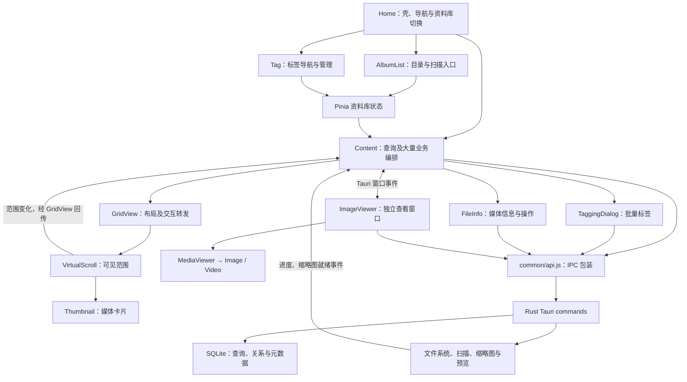
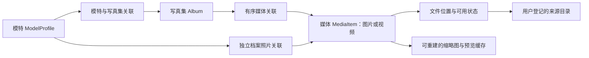
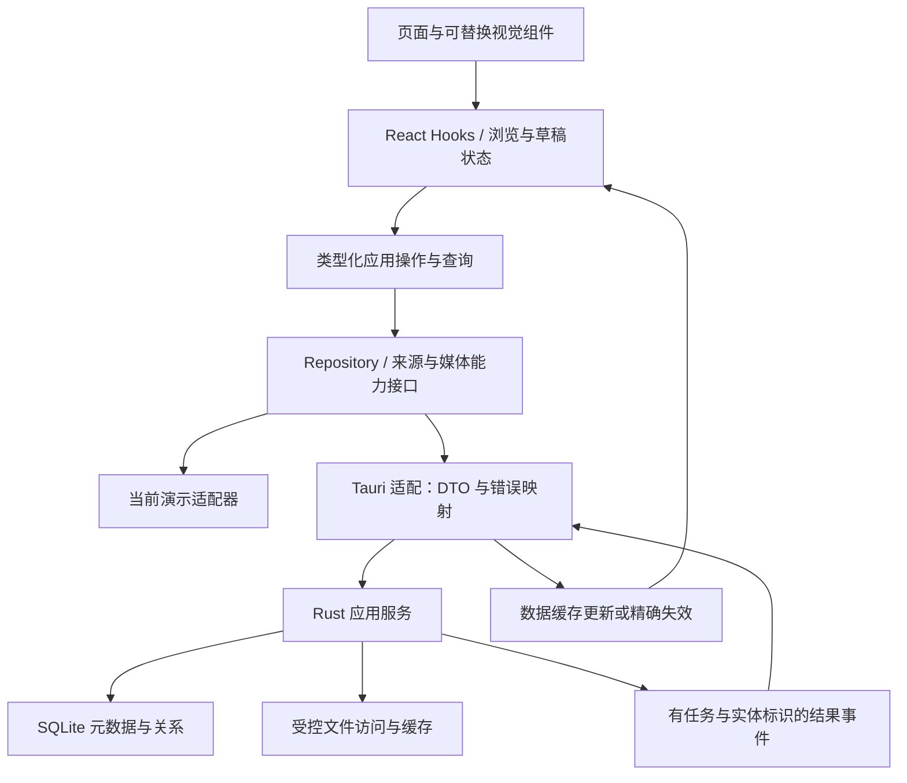

# Lap 参考分析与镜集独立实现建议

分析日期：2026-09-26。对象：[julyx10/lap](https://github.com/julyx10/lap)。

## 1. 结论与分析边界

**借鉴 Lap 的大图库浏览机制、交互状态处理和本地资源管理经验；镜集继续围绕模特、写真集与媒体组织产品，不采用 Lap 的目录中心模型、组件树或全局状态结构。**

最值得借鉴的是：可见范围驱动的数据加载、缩略图与原图分层、批量标签差量提交、稳定选择与滚动锚点、可取消的扫描，以及离线目录不误清理索引。最不适合直接采用的是：将大量业务集中到 `Content.vue`、用全局配置变更间接驱动几乎所有操作、把人物等同于人脸聚类结果，以及把磁盘目录等同于写真集。

### 1.1 固定版本与方法

- 本地参考位置：`references/lap/`（独立获取，不随源码分发）。
- Git 提交：`a9c6da9c5365a23f6cdb6633e7e8e2d37dfaa62b`，提交时间为 2026-09-25 22:41:50 +08:00，提交标题 `Update README`。
- 以浅克隆取得该提交的主仓库文件；未初始化 LibRaw、libjpeg-turbo、libheif、libde265 子模块。指定的 Vue 模块及本文追踪的应用前后端源码均已取得，第三方解码库内部实现不在本次分析范围。
- 包清单声明版本为 `0.3.2`，采用 Vue / Pinia / Tauri 2 / Rust / rusqlite。清单声明 `GPL-3.0-or-later`，根目录保留其 LICENSE。本文只分析原理，不摘录实现代码，不将其源码或资产移入镜集产品目录。[版本与依赖][S00]
- 本次是**静态源码分析**：阅读组件模板、业务处理、状态依赖、IPC 接口、Rust 查询、扫描与缓存实现；未安装 Lap 依赖、构建、启动或运行测试。
- 下文“用户交互”指模板及事件处理所表达的行为，不是实际操作验收。性能优化指代码中存在的机制，不代表已测得帧率、内存上限或图库容量。
- “事实”均限定在固定提交；“风险”是代码路径推导，尚未通过运行复现；“镜集建议”是独立方案，不是已经实现的功能。

### 1.2 与镜集当前进度的关系

镜集已有 React + TypeScript + Fluent UI + Motion + Tauri 桌面壳，以及发现、写真库、模特、标签和媒体查看相关界面。当前 `src/data.tsx` 以 `MockRepository` / `localStorage` 保存演示元数据，`src-tauri/src/main.rs` 仅启动桌面壳；真实目录扫描、SQLite 与缩略图服务尚未接入。

因此本文不是“从 Lap 开始重建应用”的计划。应保留现有类型 `ModelProfile`、`Album`、`MediaItem`，逐步提取业务边界并替换演示适配器。本阶段只交付本文，不落实目录拆分、代码重构、依赖变更或后端实现。

## 2. 先厘清产品概念

| Lap 的概念 | 从源码看到的含义 | 镜集的独立处理 |
| --- | --- | --- |
| Library | 可切换的本地资料库环境，带自身数据库和状态 | 初期单资料库即可；接口预留上下文，不引入多库 UI |
| Album | 注册的磁盘根目录，保存路径、名称、扫描范围、扫描状态和封面引用 | 增设独立的目录来源概念；不能替代现有 `Album` 写真集 |
| Folder | 根目录下的文件夹，负责路径导航与物理位置 | 放在文件夹管理中，作为来源筛选，不决定模特归属 |
| Collection | 不移动文件的逻辑媒体集合 | 可借鉴“逻辑集合与磁盘分离”，但仍需镜集自己的封面、模特关联、有序内容和业务规则 |
| Person / Face | 基于人脸信息的分组及人物入口 | 镜集的模特是手动建立的资料实体，头像、介绍和自定义信息不依赖识别 |
| Tag / TagGroup | 文件标签及分组，可批量操作 | 保留手动标签，并明确写真集标签与媒体标签的独立作用域 |

依据：目录绑定见 [Album 后端与命令][S16]；逻辑集合、人物和人脸关系见 [数据库结构][S17]。

`Model → PhotoSet → Photo` 是镜集的浏览主线，不应由这串箭头直接推出强制单一归属。当前模型已允许写真集关联多个模特、同一媒体出现在多个写真集中；本轮不改变这些关系。视频继续沿用已有 `MediaItem.kind` 扩展，不将主线改成面向所有格式的专业影像工具。

## 3. Lap 的组件协作与数据流



这不是严格的单向架构：子组件还直接读取配置、调用 API、收发 Tauri 事件，部分对象由多个组件共同修改。`common/config.js` 用代理暴露 Pinia 的配置与资料库状态；`uiStore` 管活动面板、输入处理栈、资源版本和编辑调整；`libraryStore` 同时保存导航、筛选、扫描和部分显示状态。[状态入口][S12]

`App.vue` 深度监听资料库状态并触发保存；`libraryStore.save` 会排除部分运行时计数及激活标记，并比较序列化结果以避免重复写入。值得借鉴的是“区分需要持久化的状态”，不宜沿用“所有状态先混在一起，再在保存时逐项排除”的结构。[状态持久化][S13]

## 4. 指定模块逐项分析

每个模块均按任务要求的十个维度分析。文中的镜集组件名称表示建议职责，沿用镜集已有命名的地方不要求重命名；其他名称仅为独立方案草案。

### 4.1 GridView.vue

依据：[网格展示与事件][S01]、[布局与锚点][S02]。

1. **解决的问题**：把查询结果、分组标题和占位项组织成网格或胶片条；协调可见区域与当前焦点。
2. **用户交互**：单击、双击、复选框、分组选择、拖动、改变卡片大小；支持不同网格排列，胶片条可将纵向滚轮转换为横向滚动。加载与空结果有不同提示。
3. **组件协作**：父级 `Content` 提供文件、选择和分组信息；内部组合 `VirtualScroll` 与 `Thumbnail`，把媒体操作和可见范围事件回传。网格不是数据库查询入口。
4. **数据与状态**：领域数据主要来自 props；尺寸和布局几何在组件内计算，同时读取全局网格配置和输入栈。分组时建立文件索引与渲染行索引的映射，避免把组标题误当媒体。
5. **值得借鉴**：布局、可见范围和业务操作分开；焦点与多选状态分开；调整布局时保持浏览对象；占位项与真实项有明确区分。
6. **不适合镜集**：首轮无需同时拥有卡片、密铺、等高、瀑布流、多方向胶片条和多维分组。将所有模式放进一个网格会扩大验收范围。
7. **独立组件建议**：`PhotoSetMediaPane` 负责页面组织，`MediaTile` 展示媒体，`WindowedMediaList` 控制窗口化；布局计算置于纯函数模块，选择由独立 Hook 管理。先实现现有规范中的统一比例网格。
8. **性能**：虚拟渲染、尺寸观察、稳定标识、可见范围回调和重排锚点确有实现；延迟显示加载提示可减少闪烁。但部分几何布局仍遍历整个数组，DOM 少不代表布局计算与数据内存也为常量。
9. **Windows / Tauri**：主体是 Web 布局与 Pointer/ResizeObserver 能力，没有直接数据库或 Tauri 命令；拖动事件是否对应真实文件操作由父级决定。
10. **耦合与改进**：全局配置、分组语义、几何、手势、拖动和键盘拦截集中于同一组件。镜集应向布局传入必要参数，并将快捷键限定到获得焦点的浏览区域，避免全局抢键。

### 4.2 Thumbnail.vue

依据：[卡片模板][S03]、[加载、预览与事件][S04]、[悬停协调器][S14]。

1. **解决的问题**：让一项媒体在网格内可识别、可选择、可预览并可触发操作。
2. **用户交互**：显示缩略图、媒体类型与状态标记；支持单击、双击、右键、选择框。视频及部分动态图在悬停后预览，移出停止；多选时右键转交父级共享菜单。
3. **组件协作**：接收 `GridView` 的媒体和选择状态；组合菜单，利用公共菜单生成器；悬停协调器保证同一协调范围内只有一个活动预览。
4. **数据与状态**：媒体记录来自父级；卡片保留加载完成、重试和预览状态。路径变更或卸载会清理预览，异步准备使用请求序号丢弃过时结果。
5. **值得借鉴**：缩略图与动态预览分层；正式打开前终止悬停；多选菜单操作整批目标；资源版本变化使浏览器重新读取媒体。
6. **不适合镜集**：RAW 配对、Live Photo、去重、筛片等密集徽章暂不需要。Lap 的部分布局允许放大或拉伸媒体；不能据此覆盖镜集查看器完整显示、不变形的要求。它的悬停预览也不等于镜集已定义的原尺寸预览。
7. **独立组件建议**：媒体展示使用 `MediaTile`；缩略图状态由 `useMediaThumbnail` 提供，预览生命周期由 `useHoverPlayback` 管理，业务菜单由上层传入动作描述。
8. **性能**：浏览器懒加载、有限缩略图重试、延迟预览、单一活动预览、移除视频源并释放播放资源。单项 ResizeObserver 和菜单状态也有成本，需与虚拟化一起控制挂载数量。
9. **Windows / Tauri**：借助资源 URL 工具间接依赖平台协议；Windows 缩略图 URL 与其他平台不同，并有内存 data URL 路径。组件本身不应决定这些差异。
10. **耦合与改进**：当前卡片知道文件路径、协议、平台播放条件、全局配置和复杂菜单规则。镜集的卡片应拿到已经解析的展示资源及能力标记；批量选择模式下是否允许预览由明确策略控制。

### 4.3 VirtualScroll.vue

依据：[虚拟列表实现][S05]。

1. **解决的问题**：只挂载视口附近的项目，同时保留完整滚动空间。
2. **用户交互**：滚动长列表、调整窗口大小；媒体布局更新时尽量维持当前浏览位置，不突然跳走。
3. **组件协作**：不直接认识图片和数据库。父级提供项目、尺寸或几何数组，插槽渲染项目；输出可见范围供父级加载数据。
4. **数据与状态**：本地维护滚动偏移和视口尺寸。固定尺寸模式通过行列换算范围；几何模式用轴向起点和累计最远终点定位候选范围。
5. **值得借鉴**：滚动容器与领域渲染解耦；布局系统只需遵循几何契约；锚点修正考虑用户是否已主动滚动，避免异步更新抢回位置。
6. **不适合镜集**：不要直接移植 Vue 实现或它的几何假设；初期统一网格可选更简单的固定行高方案。需单独评估与现有 React 栈适配的实现。
7. **独立组件建议**：`WindowedMediaList` 只接受数量、稳定 key、布局参数、渲染函数及范围回调；`ViewportAnchor` 逻辑负责媒体 ID 与项内偏移，禁止依赖业务服务。
8. **性能**：固定尺寸范围计算为常数级；几何模式预处理为 O(N)，用两次二分查找范围边界，再渲染范围内 K 项，滚动定位通常为 O(log N + K)。其上界查找依赖几何起点单调，不能用于任意无序布局。
9. **Windows / Tauri**：纯 Web 能力；需要在 WebView2 验证滚轮、触控板、窗口缩放和高 DPI，不因算法相同就假定所有宿主表现一致。
10. **耦合与改进**：这是 Lap 中相对清晰的底层边界，但 `any[]`、索引回退 key 和对外暴露 DOM 都会放松约束。镜集应使用类型化项目、明确范围端点，并注意虚拟化后的键盘焦点和无障碍位置。

### 4.4 FileInfo.vue

依据：[信息面板][S06]。

1. **解决的问题**：集中呈现当前媒体的基本信息、组织信息与拍摄元数据，并提供相关操作入口。
2. **用户交互**：展开预览、文件信息、元数据和地图；查看名称、大小、尺寸、标签、集合、备注、相机及人脸；重命名、收藏、评分、转到目录或相关筛选。包含编辑调整的快速保存能力。
3. **组件协作**：接收父级当前文件，组合评分控件、直方图、地图等；一部分操作通过 emit 交给父级，另一部分直接调用 API。
4. **数据与状态**：标签、集合、人物等关联资料按选中文件加载，使用序号保护部分异步请求，并监听标签变化。面板显隐进入全局配置；重命名成功后直接修改传入对象的名称和路径。
5. **值得借鉴**：按用户意图分组，基本信息与专业元数据分开；当前项改变时只加载所需补充信息；关联信息可成为继续浏览的入口。
6. **不适合镜集**：地图、直方图、人脸查询和原图编辑不是首轮必需；把“保存资料”和“覆盖图片文件”放在同一信息面板容易混淆。模特介绍也不应塞入图片 EXIF 面板。
7. **独立组件建议**：`MediaFactsPanel` 展示基本信息，`CaptureMetadataSection` 展示可选 EXIF，`MediaRelationsSection` 展示关联；数据由 `useMediaDetails` 提供，写操作经应用服务。
8. **性能**：细节按当前文件获取，有并发请求与过时响应防护。但部分关联查询由文件变化立即触发，不能概括为“所有折叠分区都按展开懒加载”；镜集可进一步按可见性加载。
9. **Windows / Tauri**：显示真实路径、调用系统定位、请求媒体资料与编辑文件。文件重命名会影响实际文件；代码中的快速保存将来源与目标设为相同路径，属于原件写入操作。
10. **耦合与改进**：展示、持久化、文件操作、全局编辑状态和对象突变混杂。镜集让面板只发送明确意图，由服务返回新数据；磁盘重命名、写原件必须独立于写真集的显示名称编辑。

### 4.5 Tag.vue

依据：[标签导航、CRUD 与排序][S07]、[分组后端][S22]。

1. **解决的问题**：提供可搜索的标签目录、分组维护和按标签切换浏览范围。
2. **用户交互**：搜索标签、展开分组、选择标签或组、行内改名、新建、移组、删除和拖动调整组顺序；展示关联数量。默认组受保护。
3. **组件协作**：位于 Home 左侧面板；调用标签 API，使用菜单和确认框；通过资料库选中状态影响 Content，通过标签变更事件通知其他组件。
4. **数据与状态**：标签目录和分组保留在组件局部，当前筛选和折叠组保存在资料库状态。加载并行获取标签、数量和分组，检查当前请求、是否销毁及资料库是否切换。
5. **值得借鉴**：标签导航与管理紧密但可辨认；搜索时展开匹配内容；重复名称定位；删组保留标签并归入默认组，数据库事务保证关系完整。
6. **不适合镜集**：当前选择主要是单个标签或分组，不能直接满足镜集多标签 AND 筛选。先在数据库创建占位标签、取消再删除，也不适合我们要求的纯草稿语义。
7. **独立组件建议**：保留独立标签管理页面，拆为 `TagCatalogPanel` 和 `TagGroupSection`；筛选区由单独 `TagFilterBar` 维护多个标签，目录修改走标签应用服务。
8. **性能**：并行加载与请求版本保护能降低等待和错位；计数使用后端聚合。标签列表本身未在该组件内虚拟化；大量标签时仍需评估 DOM 和筛选成本。
9. **Windows / Tauri**：通过 IPC 读写标签，通过 Tauri 事件跨组件或窗口同步；拖拽排序本身是 Web 交互，没有必要让普通标签 UI 感知 IPC。
10. **耦合与改进**：目录读取、计数刷新、筛选导航、CRUD 和草稿清理都在组件里。占位创建失败清理为尽力而为，存在遗留占位数据的风险；镜集先在本地草稿输入合法名称，确认后再创建。

### 4.6 TaggingDialog.vue

依据：[批量标签交互][S08]、[聚合与事务提交][S21]。

1. **解决的问题**：给单个或多个媒体编辑标签，同时保留各媒体原有标签差异。
2. **用户交互**：看到全选、部分选中、未选中的三态；搜索或新建标签，循环改变状态，确认或取消；键盘可在搜索框与标签列表间导航。
3. **组件协作**：Content 和 ImageViewer 提供目标媒体 ID；对话框加载标签目录及该批对象的标签计数；成功时回传媒体标签状态并发送标签变更事件。
4. **数据与状态**：区分初始全选/部分选中状态与用户增删意图。提交的是待增加与待移除的标签 ID，不是把一份统一标签数组覆盖到所有图片。收到目录变化时可重新加载并保留未提交意图。
5. **值得借鉴**：三态 + 差量提交是直接适合镜集的设计。后端按选择集合聚合计数，并在同一事务中更新关系及派生状态，避免逐张调用 IPC。
6. **不适合镜集**：对话框中的新建、改名和删除标签目录会立即落库，取消仅取消关联编辑，不能撤销这些目录操作。它不符合用户可能理解的“取消整个对话框全部操作”。
7. **独立组件建议**：`BatchTagDialog` 专注关联差量；`useBatchTagDraft` 管理三态和意图；标签目录维护放到管理页。若允许就地新建，需明确立即创建的语义或纳入同次提交。
8. **性能**：批量聚合代替逐文件查询；后端临时选择表分批填充，提交复用预编译语句并使用事务。但逐媒体×变更标签的写入仍有成本，极大选区需任务进度与可恢复错误处理。
9. **Windows / Tauri**：没有特定 Windows 视觉要求；核心依赖 Tauri 命令与事件。镜集用可序列化业务 DTO 传递目标和差量即可。
10. **耦合与改进**：目录管理、关联草稿、同步事件和键盘焦点共处。建议让服务统一校验目标、处理失败和返回受影响实体；UI 不负责广播全局重载。

### 4.7 AlbumList.vue

依据：[目录列表与扫描编排][S09]、[目录选择上下文][S15]。

1. **解决的问题**：组织已登记的媒体根目录、子目录导航，以及扫描和维护入口。
2. **用户交互**：选中根目录、展开子目录、搜索文件夹、查看封面和数量、重排、增删编辑、启动或暂停扫描；目录离线时仍可使用缓存目录信息。
3. **组件协作**：组合 AlbumFolder、AlbumEdit、导入对话框和菜单；通过选择 composable 与后代共享当前目录；作为移动目的地选择器时采用不同选择行为。
4. **数据与状态**：组件持有目录树及封面，资料库状态持有选择与扫描队列。保存范围变化时会先取消扫描，再保存并重新排队；失败还要恢复被本次操作打断的任务。
5. **值得借鉴**：磁盘位置作为独立可管理对象；离线状态与空目录区分；子目录按需展开；选择先反馈，再进行慢速可访问性检查；封面引用稳定媒体 ID。
6. **不适合镜集**：它是目录管理树，不能成为模特写真集主页。目录移除不应使镜集逻辑写真集和模特资料一起消失；不复用它的扫描队列控制逻辑到写真集卡片。
7. **独立组件建议**：`StorageRootPanel` / `FolderBranch` 管来源导航；`ScanTaskPanel` 展示任务；写真库继续使用现有写真集卡片和详情页，通过来源关联访问媒体。
8. **性能**：目录缓存、异步访问检查、复用在途缩略图请求、计数刷新和惰性子树读取。封面加载循环与全目录记录搜索在大来源数量下仍需评估，不默认具有全树虚拟化。
9. **Windows / Tauri**：真实目录访问、扫描取消、磁盘离线和窗口事件；封面加载存在 Windows 专用数据 URL 分支。
10. **耦合与改进**：显示列表同时安排扫描、取消、错误恢复、清理选择及发送多种刷新事件，且与 Content 共享队列协议。镜集扫描调度应归后端任务服务，列表只负责请求和显示状态。

### 4.8 AlbumEdit.vue

依据：[目录编辑与预检][S10]。

1. **解决的问题**：创建或修改受管理目录的名称、描述与扫描包含范围，并让用户预估影响。
2. **用户交互**：选择目录、填写名称/描述、排除媒体类型或子目录、设置小图过滤、查看文件数量和体积、查看扫描统计；新建时检查重复及嵌套根目录。
3. **组件协作**：AlbumList 打开对话框并传入保存中状态；AlbumEdit 负责表单与预检，确认时发出参数，由父级实际保存和调度扫描。
4. **数据与状态**：草稿和初始过滤条件分离；修改条件触发延迟预检。磁盘探测串行执行，只让最新请求更新界面；扫描完成刷新统计，不覆盖尚未保存的表单字段。
5. **值得借鉴**：提交前展示影响；异步统计与编辑草稿隔离；防止连续编辑造成多个目录遍历并发；旧请求完成后不污染新条件。
6. **不适合镜集**：路径与扫描范围不是写真集名称/封面编辑的必填内容。禁止嵌套来源是一种产品策略，不应未经评估照搬；允许重叠来源时需去重和来源归属规则。
7. **独立组件建议**：将其启发用于 `FolderSourceDialog` 与 `ImportScopePreview`；镜集现有 `AlbumEditor` 仍只编辑逻辑写真集，封面选择交给独立 `CoverChooser`。
8. **性能**：输入防抖、对话框内短期缓存、缓存条目限制、串行探测、请求失效判断和卸载清理。具体时间和容量应根据镜集测量确定，不移植 Lap 数值。
9. **Windows / Tauri**：系统目录选择和后台目录探测；需要考虑中文路径、不可访问目录、外接盘和扫描中断。表单组件不应直接控制文件系统。
10. **耦合与改进**：目录校验、统计算法、进度监听和表单职责混合，确认事件参数也较散。镜集应提交类型化草稿，预检服务返回结构化统计，不能用仅前端校验替代后端路径校验。

### 4.9 ContextMenu.vue

依据：[菜单实现][S11]。

1. **解决的问题**：统一按钮菜单和鼠标右键菜单的展示、位置及子菜单行为。
2. **用户交互**：菜单从触发器或鼠标位置打开；视口边缘自动调整；子菜单悬停展开、短暂移出延迟关闭；点击外部或 Escape 关闭，支持隐藏/禁用项及快捷键文字。
3. **组件协作**：调用者提供动作数组或异步生成函数；菜单只调用动作。文件、目录、标签等上层负责定义业务含义。
4. **数据与状态**：局部保留是否打开、已解析项、坐标及子菜单状态；内容 Teleport 到 body，避免被卡片裁剪；请求序号防止等待菜单期间的后续点击又把旧菜单打开。
5. **值得借鉴**：菜单容器与业务动作分离、按打开时计算可用操作、处理边界和异步打开竞争、多选使用共享菜单。
6. **不适合镜集**：不应重新复制这套菜单和 CSS。镜集已有 Fluent UI，优先沿用现有菜单能力；也不需要导入所有文件编辑与外部应用动作。
7. **独立组件建议**：`MediaActionsMenu` 将当前目标与能力映射成动作描述，再交现有 Fluent 菜单展示；键盘快捷键和工具栏调用同一业务动作入口。
8. **性能**：按需生成项，`shallowRef` / `markRaw` 避免图标深层响应式处理；卸载清理监听和计时器。镜集只吸收按需生成原理，不移植 Vue 手段。
9. **Windows / Tauri**：这本身是 Web 菜单，不是 Windows 原生右键菜单，也没有直接 Tauri 调用；菜单动作才可能定位文件或操作窗口。
10. **耦合与改进**：业务耦合较低，但自定义键盘逻辑主要处理 Escape，模板未体现完整 ARIA 菜单语义和方向键焦点模型。不能仅凭“有快捷键标签”就认定键盘可用性完整。

### 4.10 ImageViewer.vue

依据：[独立查看器][S18]、[图片预取与加载][S19]。

1. **解决的问题**：在独立 Tauri 窗口查看图片/视频并与主浏览列表同步，兼顾单图和比较工作流。
2. **用户交互**：上一项/下一项、缩放、适应窗口、实际尺寸、全屏、幻灯片、收藏、评分、标签、旋转；另有双屏/四屏对比和同步视口。
3. **组件协作**：ImageViewer 是窗口编排层，内部 MediaViewer 再组合 Image / Video；向 Content 请求指定索引的媒体，接收更新事件；资料变化同步回主窗口。
4. **数据与状态**：初始 ID、索引、数量和下一项路径来自窗口参数；后续通过 Tauri 事件同步。各比较面板单独保存媒体与缩放状态，配置保存部分显示偏好。
5. **值得借鉴**：查看器沿进入时的结果顺序浏览；媒体渲染与窗口组织有一定分离；下一项预热、快捷键屏蔽输入框、媒体变更后维持关联 UI 一致。
6. **不适合镜集**：首轮继续使用既有应用内沉浸路由，不增加独立窗口和四屏比较。Lap 的面板、工具栏与筛片功能也不能覆盖镜集默认单图、按需显示信息的体验。
7. **独立组件建议**：`ImmersiveMediaPage` 组合 `MediaCanvas`、`ViewerControls`、`MediaFactsPanel`；`useBrowseSession` 管来源、顺序和返回锚点，`DesktopWindowAdapter` 管全屏。媒体渲染不依赖某个列表组件存活。
8. **性能**：下层 Image 实现当前项与下一项预加载缓存、空闲时预热、旧加载失效及定时器清理。需限制原图解码数量，不能把整个写真集预载进内存。
9. **Windows / Tauri**：独立窗口、焦点、显示/关闭、跨窗口事件；Windows 全屏切换还保存最大化状态并按顺序还原。该平台状态机需要独立验证，不能把浏览器 Fullscreen API 当作等价行为。
10. **耦合与改进**：导航依赖主窗口响应，跨窗口消息承载多种业务；`fileId` 的异步元数据 watcher 未像网格查询那样检查请求版本，快速切换时有旧响应覆盖新项的风险。收藏/评分先改视图再调用 API，未检查失败回滚，而筛片标记另有回滚；镜集应统一 mutation 契约。这些是静态风险，未运行复现。

### 4.11 Home.vue

依据：[壳与导航][S20]。

1. **解决的问题**：装配桌面标题栏、侧栏、功能面板、主内容、资料库菜单及特殊状态。
2. **用户交互**：切换导航和资料库、展开/折叠侧栏、拖动分隔条、显示集合区、打开设置；空资料库引导添加目录，数据库损坏显示专门状态。
3. **组件协作**：动态挂载 Library / AlbumList / Tag 等面板，组合 Content 和 CollectionTray；通过 refs、全局配置与 Tauri 事件协调入口。
4. **数据与状态**：应用配置决定布局和导航；切库先保存旧状态、阻止自动保存、取消后台工作，再切后端、重载状态，通过版本 key 重挂子树并发出通知。
5. **值得借鉴**：应用壳负责装配、状态恢复以及空/异常入口；慢操作有覆盖状态；布局动画与实际布局变更区分，减少网格反复重排。
6. **不适合镜集**：Lap 的 Home 是工作区外壳，不是 Netflix 式“发现”内容首页。将所有过滤器都变成左侧专用面板，会削弱镜集以模特和写真集为主的内容浏览层级。
7. **独立组件建议**：沿用镜集应用壳和 React 路由；分别组织发现页、写真库页、模特页与来源管理页；应用初始化、任务生命周期、窗口服务不写在发现页中。
8. **性能**：按状态挂载面板；侧栏动画后才提交部分布局改变；切库重新挂载可以清理旧树，但代价是丢弃页面缓存和局部状态，需谨慎使用。
9. **Windows / Tauri**：平台标题栏、设置独立窗口、窗口最小化恢复和聚焦。代码特别处理 Windows 旧设置窗口显示失败后的重建。
10. **耦合与改进**：壳直接调用数据库健康探测、管理扫描停止、更新检查和窗口创建，职责偏多。健康探测 IPC 失败时置为非损坏是降级选择，但不能当作已确认健康；镜集应保留“无法判断”状态并提供重试。

## 5. Content.vue 为什么不能照搬

固定提交中该文件共 **10,354 行**，包括模板、脚本和样式。判断过度耦合的依据并非单看行数，而是它同时拥有以下会互相影响的职责：[查询与加载][S23]、[扫描队列][S24]、[文件操作][S25]、[批量修改与窗口][S26]。

| Lap 中集中承担的职责 | 镜集建议边界 | 应遵循的依赖规则 |
| --- | --- | --- |
| 查询条件拼装、结果计数、分组、分页 | 媒体查询服务 + 查询缓存 | 返回领域数据，不返回具体 UI 行样式 |
| 可见范围补数、缩略图调度、布局刷新 | 视口加载 Hook + 媒体资源服务 | 以查询版本与资源版本隔离请求 |
| 焦点、多选、范围选择、全选、恢复 | 浏览会话 Store + 选择 Hook | 按稳定媒体 ID，不依赖 DOM 或已加载页面 |
| 扫描队列、开始/取消、进度更新 | Rust 扫描任务服务 + 前端任务 Store | 页面卸载不破坏任务；前端不成为唯一队列所有者 |
| 标签、收藏、评分、备注 | 明确的应用层操作 | 一次业务提交返回成功数据或结构化错误 |
| 复制、移动、重命名、删除及冲突 | 文件操作服务 | 与解除写真关联不同；原件操作单独授权 |
| 单图、快速预览、比较窗口、编辑窗口 | 浏览会话服务 + 平台窗口适配 | 查看器不反向调用网格组件取得下一项 |
| 地图、AI 搜索、人脸、去重及相似项 | 可选独立功能域 | 当前不实现，不以预留为由加入空代码 |
| 打印、壁纸、外部应用、拖放 | 桌面能力适配 | 页面只发意图，集中处理平台差异 |

Lap 已有 API 包装、部分 composable 和相对独立的虚拟列表，不能概括为“完全没有分层”。问题在于业务编排大多仍回到 Content；仅把它的函数搬到一个巨大 Hook，也只是更换耦合的位置。

此外，`t_sqlite.rs` 同时包含多个实体、查询生成、关系写入、缩略图调度/缓存和数据库初始化，`t_utils.rs` 包含大量文件及扫描逻辑。镜集后端也应按查询、来源、任务、媒体处理、数据库访问拆职责，避免只拆前端。

## 6. 后端与性能链路：借鉴机制及适用条件

### 6.1 分清三种“按需”

1. **DOM 按需**：VirtualScroll 只挂载可见范围及缓冲项目。
2. **元数据按需**：Content 先为总数建立占位槽，再根据可见范围查询块；用在途请求集合防重复，用查询版本拒绝旧结果。先加载视口，再加载邻近范围。[视口查询][S23]
3. **媒体字节按需**：缩略图批量读取；不存在时后台生成，通过事件通知，再更新媒体资源。查看器才加载较大图片并有限预热下一项。[缩略图批处理][S27]

因此不能只给现有全量 `.map()` 加一个虚拟列表，就宣称镜集解决了大图库问题。当前整库 JSON 读取/复制、前端全量筛选与图片解码也需要分别处理。

局限同样明确：占位数组按总数分配仍占 O(N) 空间；已加载项目和字符串引用可能继续留存。工具层的 data URL 缓存虽然按估算字节驱逐，若列表项仍引用同一字符串，缓存删除不保证内存立即释放。镜集需要可淘汰的分页数据与可测量的资源预算。

### 6.2 SQLite 查询与写入

- Lap 的查询统一接收条件，在 Rust 生成筛选和排序，查询使用绑定参数及 `LIMIT / OFFSET`；计数和页面数据分开获取。[分页查询][S28]
- 数据库开启 WAL、忙等待和外键，连接可归还池中；切换资料库时检查连接对应路径。迁移通过 `user_version` 推进，并包含关系表与索引演进。[连接配置][S29]、[迁移][S30]
- 标签批量修改使用事务，删除标签同时维护关联状态；删组将成员归入默认组，保持标签存在。[标签事务][S21]、[分组事务][S22]

**镜集建议**：先围绕模特、写真集、媒体及关联表设计自己的 schema 和迁移；每个保存操作明确事务边界。查询排序必须带稳定的次级键，分页结果携带查询/资料库版本；大偏移性能先测量，再决定游标分页、位置索引或混合方式，不盲目复制一种分页策略。

**限制**：Lap 部分命令虽标记为 async，内部仍直接执行同步 rusqlite 查询；“异步命令”不等于已经移出阻塞工作。它的连接池代码也不是一个显式限制活跃连接数量的完整调度器。镜集需统一安排数据库与耗时磁盘工作，而不是给函数加 async 后就视为性能问题已解决。

### 6.3 缩略图与缓存

- 前端存在按资料库、媒体和缩略图尺寸组织的 data URL 缓存、在途请求复用与字节预算；切库清空。URL 可携带资源版本以绕过旧缓存。[前端资源层][S31]
- 后端提供批量缩略图获取；缺失时调度后台生成。后台任务有去重与信号量，耗时生成进入 `spawn_blocking`，完成发出 `thumbnail_ready`。[后台缩略图][S32]
- 数据库记录缓存键、文件时间与尺寸等信息，同时存在磁盘缓存读取路径；不能简单说“全部缩略图都只在 SQLite”或“全部通过 URL 传输”。[缓存结构][S17]、[后台缩略图][S32]
- 自定义 thumb / preview 协议返回媒体字节；Windows 前端使用 HTTP 形式的本地协议地址，原始资产用 `convertFileSrc` 转换。[资源协议][S33]

**镜集建议**：UI 接收稳定媒体 ID 和解析后的 URL；资源服务负责缩略图状态、尺寸档位、缓存失效和能力降级。缓存键至少考虑资料库、媒体版本和变体，缩略图文件独立于原件。任务队列限制并发、去重、优先显示当前视口；预取可以取消，原图解码同样需要数量限制。

协议命名空间还必须在后端实际参与资源定位，不能仅改变前端 URL。Lap 的 preview 协议注释明确把资料库段用于浏览器缓存隔离，文件读取仍取当前库；thumb 缺失生成路径也读取当前库。对镜集而言，若后续支持多库，建议显式绑定任务的资料库上下文并在响应时核对，避免把命名空间等同于完整隔离。该点是源码边界分析，不宣称已复现串库错误。[协议处理][S33]

### 6.4 目录、扫描与原件保护

Lap 的扫描命令启动后台工作，前端监听进度和完成事件；扫描维护取消标记及并发保护，后台遍历文件夹、更新元数据并生成媒体缓存。[扫描入口][S16]、[扫描过程][S34]

值得特别借鉴：只有完整成功遍历才执行清理未见文件的步骤；取消、离线或遍历失败不按完整结果更新目录统计，避免误把不可访问文件当作已删除。目录状态缓存也让侧栏无需反复走磁盘。[扫描收尾][S35]

镜集应进一步将“磁盘缺失”和“用户移出收藏库”分开：原文件找不到时保留模特资料、写真集及手动标签，标记离线/缺失并支持重新定位。不要直接继承 Lap 以物理文件索引为中心的级联删除结果。

任务应有稳定任务 ID、来源 ID、阶段、计数和明确状态：等待、扫描中、取消中、已取消、完成、部分失败、失败。收到“命令已接受”不能显示“扫描完成”；前端版本失效只能防旧结果覆盖，不等于已取消后端 CPU/磁盘工作。

### 6.5 Windows / Tauri 能力取舍

| 参考能力 | Lap 的实现线索 | 镜集建议 |
| --- | --- | --- |
| 访问用户目录 | 注册目录时授权、启动时恢复范围 | 按用户选择的来源授权，Rust 校验路径范围；不照搬宽泛资产 scope |
| 系统定位文件 | Windows 下调用 Explorer 定位 | 封装在桌面适配器，UI 传媒体 ID，由后端解析实际路径 |
| 窗口全屏与恢复 | Windows 保存最大化状态并顺序切换 | 先满足单窗口查看器；验证最大化、全屏退出、高 DPI 与焦点恢复 |
| 独立设置/查看窗口 | Tauri WebviewWindow 与事件通信 | 目前不引入；确有需求时增加带会话 ID 的协议 |
| 解码与预览 | 浏览器播放器、Rust 图片处理及多种第三方解码路径 | 初期明确实际支持的样本集；不把生成封面成功等同于视频播放成功 |
| 权限、更新及外部操作 | 配置中有较广权限、更新器和其他集成 | 按镜集实际功能最小引入；不复制更新端点、标识、遥测或品牌资产 |

依据：[权限与作用域][S36]、[Windows 系统定位][S37]、[查看器][S18]、[Home][S20]。本次没有研究第三方解码器内部，也没有验证安装包或媒体兼容范围。

## 7. 镜集自己的组件与数据架构建议

### 7.1 保留产品主线，分离来源



这是一组建议关系，不是本轮 schema 变更：

- 写真集名称、简介和封面独立于文件夹名称；一个写真集可组织来自不同目录的媒体，导入时可以提供“按文件夹创建写真集”的便捷操作，但不是强制等价关系。
- 模特资料独立保存；头像、背景、档案照片与写真集内容的关联各自明确。头像不是自动裁剪的人脸聚类结果。
- 保留现有多模特和媒体复用能力，通过显式关联表达顺序与角色；不把同一照片复制多份作为关联实现。
- 媒体拥有稳定身份；磁盘路径是可变位置。来源不可访问时标记状态，恢复路径后复用元数据和关联。
- 手动标签应用于写真集或媒体时必须明确目标；默认不做隐式继承或自动回写，是否增加继承另行定义。
- 封面保存引用与裁切焦点等元数据，图片与视频 poster 都经过资源服务解析；缺失时保留可修复的引用而非静默换错封面。

### 7.2 建议的组件职责

| 页面/组合 | 展示组件建议 | 对应 Hook / Store | 业务入口 |
| --- | --- | --- | --- |
| 发现与写真库 | 现有写真卡片、内容轨道、筛选条 | `usePhotoSetQuery` | 写真集查询服务 |
| 写真详情 | `PhotoSetHeader`、`PhotoSetMediaPane`、`MediaTile` | 查询状态、选择状态、视口范围 | 写真集业务服务、媒体查询服务 |
| 写真编辑 | 沿用 `AlbumEditor` 入口，拆封面与关联选择 | 独立编辑草稿 | 保存写真集及关联 |
| 模特资料 | 头像、资料分区、关联写真轨道 | `useModelProfile`、编辑草稿 | 模特业务服务 |
| 沉浸浏览 | `MediaCanvas`、控件、按需信息面板 | `useBrowseSession`、缩放/播放状态 | 媒体解析、收藏/标签服务、窗口适配 |
| 标签管理与批量关联 | 标签目录、分组、三态对话框 | 标签目录缓存、批量草稿 | 标签业务服务 |
| 本地文件夹管理 | 来源列表、目录树、任务状态 | 来源查询、扫描任务 Store | 来源服务、Rust 任务服务 |

UI 的局部状态只保留打开/关闭、焦点、当前输入等；共享浏览状态保留筛选、排序、选中 ID 和来源锚点；领域数据与查询缓存放数据层；持久化偏好与运行时任务分开。继续使用当前 React 技术栈，是否需要额外 Store 库应依据后续实现复杂度评估，不因 Lap 使用 Pinia 而重选框架。

### 7.3 建议文件边界

以下是逐步演进方向，**本轮不创建这些目录**，也不强制每个模块拥有所有层级：

```text
src/
  domain/                 领域类型、关系约束、无平台依赖的规则
  application/            保存资料、关联媒体、批量标签等业务操作
  data/                   Repository 接口、查询缓存、演示适配器
  platform/               Tauri 通信、窗口和资源 URL 适配
  features/
    photo-sets/           写真集页面、编辑草稿与展示组件
    model-profiles/       模特资料与关联浏览
    media-browser/        网格、视口加载与选择
    immersive-view/       媒体显示与浏览会话
    tag-catalog/          标签维护与关联编辑
    folder-sources/       来源管理与任务展示
  ui/                     通用控件和设计 Tokens

src-tauri/src/
  commands/               校验与序列化边界
  catalog/                元数据、关系与查询业务
  sources/                路径登记、可访问性及来源解析
  jobs/                   扫描、取消、进度和恢复
  media/                  元数据提取、缩略图与预览
  persistence/            SQLite、事务与版本迁移
```

迁移入口：逐步拆 `src/data.tsx` 的领域类型、演示数据、持久化和 React Provider；将现有编辑器与页面里的复杂 `mutate` 回调提成应用操作；将 `src/viewer.tsx` 的 Tauri 窗口调用移入平台适配。小修复不必触发整体搬迁。

### 7.4 稳定接口与单向数据流



建议接口按业务意图划分，不直接暴露 SQL、Tauri 命令名、整库数据或回调函数：

| 能力 | 输入与输出要点 | 一致性要求 |
| --- | --- | --- |
| 查询写真/媒体 | 明确筛选、稳定排序、分页参数 → 摘要列表、总数或可继续标记、查询版本 | 旧查询结果不得覆盖新查询；错误不伪装为空数组 |
| 保存写真/模特 | 类型化草稿、关联和预期版本 → 完整保存结果 | 资料与关联同事务；失败保留草稿 |
| 批量标签 | 显式目标范围、增加/移除意图 → 受影响对象状态 | 不覆盖未修改标签；全选范围不能只包含已加载卡片 |
| 修改收藏/评分 | 实体标识与目标值 → 确认后的状态 | 乐观更新有回滚；主页面与查看器共享结果 |
| 开始扫描 | 来源标识与范围 → 任务标识 | 进度携任务/来源标识；取消有确认终态 |
| 获取媒体资源 | 媒体标识、用途与尺寸 → URL、版本、可用状态 | 缓存可重建；后台绑定来源上下文；过期响应可识别 |
| 定位磁盘文件 | 媒体标识 → 执行结果 | 后端解析路径与可用性，不信任 UI 拼接路径 |

当前 `Repository.update(callback)` 只适用于内存演示适配，不能跨 IPC 序列化；后端接入前应先有这些可序列化的业务请求。不要在组件中堆 `if (isTauri)` 分别实现两套保存规则。

### 7.5 三条关键流程

**打开写真集**：路由得到写真集 ID → Hook 查询资料和首屏媒体摘要 → 网格报告视口 → 查询服务补齐分页 → 资源服务提供缩略图 → 后台就绪事件只更新对应媒体。进入查看器时记录来源筛选、媒体顺序或查询快照、当前 ID 与返回锚点；退出恢复原位置。

**保存模特资料**：编辑器持有完整草稿 → 应用层校验资料及关联 → Repository 原子保存 → 返回确认后的资料和受影响关联 → 缓存更新 → 关闭编辑器。失败时保持草稿，不靠页面手动改多个数组制造“已保存”。

**登记文件夹并扫描**：系统选择目录 → 后端规范化路径与校验范围 → 登记来源 → 用户确认扫描范围 → 创建任务 → 渐进写入媒体元数据并发布进度 → 按视口优先生成缩略图。中断或掉盘时保留已登记资料与可恢复状态；逻辑写真集是否自动创建作为独立应用操作。

## 8. 推荐优先实现的模块与验收目标

这里只给后续开发顺序；分析完成后停止，不自动开始以下工作。

| 优先级 | 模块 | 理由 | 建议验收产出 |
| --- | --- | --- | --- |
| P0 | 领域类型、业务操作与数据适配边界 | 当前 UI 已存在，先给替换 localStorage 的工作提供稳定接口 | 同一保存/关联操作可通过演示适配验证；取消和失败不破坏草稿 |
| P0 | SQLite 元数据、关系与迁移 | 名称、封面、模特资料和手动标签是长期资产 | 重启保留数据；关联事务与外键正确；迁移不清空资料 |
| P0 | 来源登记、路径解析和可取消扫描 | 形成真实本地图库最小闭环 | 中文/空格路径、重复登记、掉盘、取消、重试均有明确结果；不修改原件 |
| P0 | 缩略图服务、分页查询与固定比例虚拟网格 | 本地媒体规模一扩大就会暴露性能问题，应作为一条链路完成 | 快速滚动和筛选不串图；视口优先；DOM、缓存与后台并发有界 |
| P1 | 自定义写真集、封面与模特关联接入真实数据 | 落实镜集区别于文件浏览器的核心价值 | 重命名不改磁盘文件夹；封面稳定；资料与关联一致保存 |
| P1 | 图片查看器与浏览会话 | 已有原型，重点连接真实资源和可靠返回 | 原比例/适应窗口、缩放、连切、全屏和返回恢复；失败可换项；视频不回退为假播放 |
| P1 | 手动标签、组合筛选、收藏和搜索 | 建立可持续整理和查找能力 | 批量三态差量；多标签 AND；搜索/收藏变更与查看器一致；异步失败可恢复 |
| P2 | 增量扫描、重新定位、缓存清理与备份恢复 | 完成外接盘及长期维护场景 | 外部移动后可恢复关联；缓存可重建；资料有恢复路径 |

首轮不推荐加入：AI 搜索、人脸聚类、地图、去重、多屏比较、专业修图、多资料库切换与发布更新系统。这不是永久排除，而是它们不在当前关键闭环中，并会显著增加数据及交互复杂度。

性能验证应使用可丢弃的不同规模图库，例如小样本、万级、十万级，分别测冷启动与热缓存、首屏可用时间、分页延迟、滚动长任务、DOM 数量、缓存/解码内存、队列长度以及扫描期间交互。具体阈值取决于目标设备和媒体尺寸，本次没有基准测量，不把示例规模写成支持承诺。

## 9. 差异化与不应借鉴的部分

| 维度 | Lap 的重点 | 镜集应保持的方向 |
| --- | --- | --- |
| 信息架构 | 文件夹、筛选维度、专业媒体整理 | 模特 → 写真集 → 媒体；文件夹作为独立来源 |
| 首页 | 工具工作区外壳 | 明亮的发现页、写真集封面与内容轨道；Hero 不阻挡查找和管理 |
| 人物 | 人脸聚类及识别入口 | 手动档案、独立头像和背景、介绍及自定义字段 |
| 集合 | 目录、逻辑集合、规则集合并存 | 明确的写真集资料、封面、有序内容与模特关系 |
| 网格 | 多模式、分组、徽章和筛片 | 简洁一致的图片网格；复杂布局有实际需求再引入 |
| 查看 | 单图、胶片条、独立窗口与多屏比较 | 单窗口沉浸浏览，按需工具和信息面板 |
| 视觉 | Lap 自身主题、图标与控件 | 镜集自己的浅色蓝白 Tokens、Fluent 基础控件与品牌资产 |
| 状态 | 广泛可变配置、事件及组件内编排 | 浏览会话、编辑草稿、领域数据、任务和偏好各有边界 |
| 原件管理 | 包含复制、移动、删除及图片编辑 | 默认管理资料与关联；原件变更单独表达并授权 |
| 工程复用 | Vue / Pinia 及配套实现 | 继续当前 React 栈；学习机制，不复制组件、命名方案或资源 |

应明确避免的实现方式：整页复制大型组件；所有业务塞进一个 Store/Hook；把 async 当作阻塞工作的解决方案；API 吞错后让 UI 显示成功；无差别全局刷新；全量 JSON 整库读取用于大图库；无界图片预取；用原件路径充当不可变 ID；未完整扫描就清理记录；使用对话框取消掩盖已经发生的持久化副作用。

## 10. 本次交付与后续待验证事项

本次交付范围为参考仓库与本文。没有引入 Lap 依赖，没有安装或运行参考工程，没有复制实现代码、组件、CSS 数值或品牌素材到镜集应用中。文中出现的 Lap 文件名、类型和函数名仅用于分析定位，不是建议复用其命名方案。

后续需要运行验证而本文不能下结论的事项：真实图库下的性能、Windows 全屏和焦点恢复、WebView2 对用户实际媒体的解码、长路径/外接盘行为，以及文中指出的响应竞争和失败回滚风险。现有测试文件或仓库说明不替代这些验证。

## 11. 源码定位索引

以下链接全部固定到本次提交，避免仓库后续变化使结论失去依据。引用用于说明设计与实现，不代表推荐移植对应源码。

- [S00：Rust 包清单与许可证声明][S00]；前端包清单位于 `src-vite/package.json`。
- [S01：GridView 组件边界][S01]；[S02：布局、锚点与生命周期][S02]。
- [S03：Thumbnail 展示与输入][S03]；[S04：加载、预览和右键][S04]。
- [S05：VirtualScroll 算法和清理][S05]。
- [S06：FileInfo 信息操作与异步加载][S06]。
- [S07：Tag 目录维护][S07]；[S08：TaggingDialog 三态和差量提交][S08]。
- [S09：AlbumList 目录与扫描编排][S09]；[S10：AlbumEdit 预检与表单][S10]。
- [S11：ContextMenu 按需打开与定位][S11]。
- [S12：Pinia 代理入口][S12]；[S13：资料库状态与保存][S13]。
- [S14：悬停预览协调][S14]；[S15：目录选择上下文][S15]。
- [S16：目录登记、删除、封面与扫描命令][S16]；[S17：核心表结构][S17]。
- [S18：ImageViewer 窗口及媒体同步][S18]；[S19：Image 加载及预取][S19]。
- [S20：Home 生命周期、切库和设置窗口][S20]。
- [S21：标签计数和事务写入][S21]；[S22：标签分组事务][S22]。
- [S23：Content 分页及视口补数][S23]；[S24：Content 扫描调度][S24]。
- [S25：Content 文件操作][S25]；[S26：Content 批量业务与窗口][S26]。
- [S27：批量缩略图 IPC][S27]；[S28：SQLite 分页查询][S28]。
- [S29：SQLite 连接和 WAL][S29]；[S30：数据库迁移][S30]。
- [S31：资源 URL、缓存和失效][S31]；[S32：后台缩略图生成][S32]。
- [S33：thumb / preview 协议][S33]；[S34：目录扫描过程][S34]；[S35：完整扫描后的清理][S35]。
- [S36：Tauri 资源配置][S36]；[S37：系统文件定位][S37]；[S38：API 错误处理][S38]。

其中 ImageViewer 的失败回滚分析需结合 [API 包装的空值返回行为][S38]；窗口与媒体内核职责还可沿 `components/MediaViewer.vue` 继续追踪。参考目录始终保持只读，后续研究不在其中安装或写入运行产物。

[S00]: https://github.com/julyx10/lap/blob/a9c6da9c5365a23f6cdb6633e7e8e2d37dfaa62b/src-tauri/Cargo.toml
[S01]: https://github.com/julyx10/lap/blob/a9c6da9c5365a23f6cdb6633e7e8e2d37dfaa62b/src-vite/src/components/GridView.vue#L1-L203
[S02]: https://github.com/julyx10/lap/blob/a9c6da9c5365a23f6cdb6633e7e8e2d37dfaa62b/src-vite/src/components/GridView.vue#L297-L673
[S03]: https://github.com/julyx10/lap/blob/a9c6da9c5365a23f6cdb6633e7e8e2d37dfaa62b/src-vite/src/components/Thumbnail.vue#L1-L227
[S04]: https://github.com/julyx10/lap/blob/a9c6da9c5365a23f6cdb6633e7e8e2d37dfaa62b/src-vite/src/components/Thumbnail.vue#L229-L528
[S05]: https://github.com/julyx10/lap/blob/a9c6da9c5365a23f6cdb6633e7e8e2d37dfaa62b/src-vite/src/components/VirtualScroll.vue#L25-L399
[S06]: https://github.com/julyx10/lap/blob/a9c6da9c5365a23f6cdb6633e7e8e2d37dfaa62b/src-vite/src/components/FileInfo.vue#L452-L1014
[S07]: https://github.com/julyx10/lap/blob/a9c6da9c5365a23f6cdb6633e7e8e2d37dfaa62b/src-vite/src/components/Tag.vue#L287-L750
[S08]: https://github.com/julyx10/lap/blob/a9c6da9c5365a23f6cdb6633e7e8e2d37dfaa62b/src-vite/src/components/TaggingDialog.vue#L271-L767
[S09]: https://github.com/julyx10/lap/blob/a9c6da9c5365a23f6cdb6633e7e8e2d37dfaa62b/src-vite/src/components/AlbumList.vue#L483-L1214
[S10]: https://github.com/julyx10/lap/blob/a9c6da9c5365a23f6cdb6633e7e8e2d37dfaa62b/src-vite/src/components/AlbumEdit.vue#L291-L664
[S11]: https://github.com/julyx10/lap/blob/a9c6da9c5365a23f6cdb6633e7e8e2d37dfaa62b/src-vite/src/components/ContextMenu.vue#L1-L427
[S12]: https://github.com/julyx10/lap/blob/a9c6da9c5365a23f6cdb6633e7e8e2d37dfaa62b/src-vite/src/common/config.js
[S13]: https://github.com/julyx10/lap/blob/a9c6da9c5365a23f6cdb6633e7e8e2d37dfaa62b/src-vite/src/stores/libraryStore.js
[S14]: https://github.com/julyx10/lap/blob/a9c6da9c5365a23f6cdb6633e7e8e2d37dfaa62b/src-vite/src/common/hoverPreview.ts
[S15]: https://github.com/julyx10/lap/blob/a9c6da9c5365a23f6cdb6633e7e8e2d37dfaa62b/src-vite/src/composables/useAlbumSelection.ts#L28-L199
[S16]: https://github.com/julyx10/lap/blob/a9c6da9c5365a23f6cdb6633e7e8e2d37dfaa62b/src-tauri/src/t_cmds.rs#L529-L654
[S17]: https://github.com/julyx10/lap/blob/a9c6da9c5365a23f6cdb6633e7e8e2d37dfaa62b/src-tauri/src/t_sqlite.rs#L9574-L9958
[S18]: https://github.com/julyx10/lap/blob/a9c6da9c5365a23f6cdb6633e7e8e2d37dfaa62b/src-vite/src/views/ImageViewer.vue#L371-L1328
[S19]: https://github.com/julyx10/lap/blob/a9c6da9c5365a23f6cdb6633e7e8e2d37dfaa62b/src-vite/src/components/Image.vue#L382-L635
[S20]: https://github.com/julyx10/lap/blob/a9c6da9c5365a23f6cdb6633e7e8e2d37dfaa62b/src-vite/src/views/Home.vue#L238-L773
[S21]: https://github.com/julyx10/lap/blob/a9c6da9c5365a23f6cdb6633e7e8e2d37dfaa62b/src-tauri/src/t_sqlite.rs#L8102-L8242
[S22]: https://github.com/julyx10/lap/blob/a9c6da9c5365a23f6cdb6633e7e8e2d37dfaa62b/src-tauri/src/t_tag_groups.rs#L106-L144
[S23]: https://github.com/julyx10/lap/blob/a9c6da9c5365a23f6cdb6633e7e8e2d37dfaa62b/src-vite/src/components/Content.vue#L6020-L6571
[S24]: https://github.com/julyx10/lap/blob/a9c6da9c5365a23f6cdb6633e7e8e2d37dfaa62b/src-vite/src/components/Content.vue#L4617-L4675
[S25]: https://github.com/julyx10/lap/blob/a9c6da9c5365a23f6cdb6633e7e8e2d37dfaa62b/src-vite/src/components/Content.vue#L7976-L8787
[S26]: https://github.com/julyx10/lap/blob/a9c6da9c5365a23f6cdb6633e7e8e2d37dfaa62b/src-vite/src/components/Content.vue#L8924-L10154
[S27]: https://github.com/julyx10/lap/blob/a9c6da9c5365a23f6cdb6633e7e8e2d37dfaa62b/src-tauri/src/t_cmds.rs#L2503-L2660
[S28]: https://github.com/julyx10/lap/blob/a9c6da9c5365a23f6cdb6633e7e8e2d37dfaa62b/src-tauri/src/t_sqlite.rs#L4795-L4844
[S29]: https://github.com/julyx10/lap/blob/a9c6da9c5365a23f6cdb6633e7e8e2d37dfaa62b/src-tauri/src/t_sqlite.rs#L9461-L9532
[S30]: https://github.com/julyx10/lap/blob/a9c6da9c5365a23f6cdb6633e7e8e2d37dfaa62b/src-tauri/src/t_migration.rs#L237-L537
[S31]: https://github.com/julyx10/lap/blob/a9c6da9c5365a23f6cdb6633e7e8e2d37dfaa62b/src-vite/src/common/utils.ts#L387-L687
[S32]: https://github.com/julyx10/lap/blob/a9c6da9c5365a23f6cdb6633e7e8e2d37dfaa62b/src-tauri/src/t_sqlite.rs#L7571-L7710
[S33]: https://github.com/julyx10/lap/blob/a9c6da9c5365a23f6cdb6633e7e8e2d37dfaa62b/src-tauri/src/t_protocol.rs#L69-L182
[S34]: https://github.com/julyx10/lap/blob/a9c6da9c5365a23f6cdb6633e7e8e2d37dfaa62b/src-tauri/src/t_utils.rs#L3938-L4244
[S35]: https://github.com/julyx10/lap/blob/a9c6da9c5365a23f6cdb6633e7e8e2d37dfaa62b/src-tauri/src/t_utils.rs#L4248-L4325
[S36]: https://github.com/julyx10/lap/blob/a9c6da9c5365a23f6cdb6633e7e8e2d37dfaa62b/src-tauri/tauri.conf.json
[S37]: https://github.com/julyx10/lap/blob/a9c6da9c5365a23f6cdb6633e7e8e2d37dfaa62b/src-tauri/src/t_utils.rs#L1743-L1786
[S38]: https://github.com/julyx10/lap/blob/a9c6da9c5365a23f6cdb6633e7e8e2d37dfaa62b/src-vite/src/common/api.js#L1480-L1503
